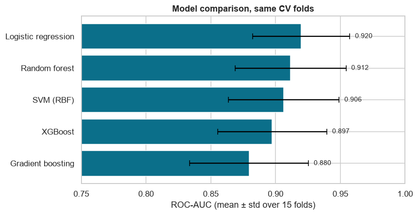
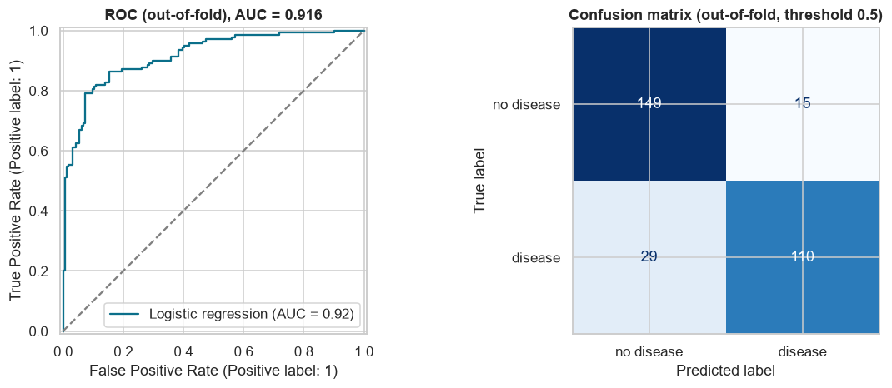
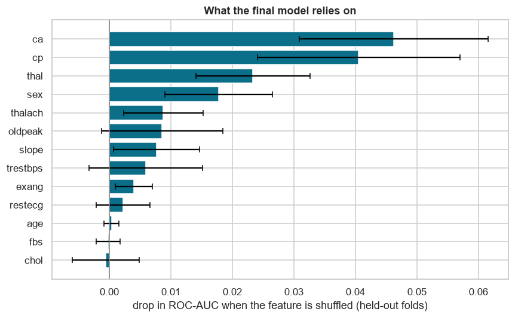

# Heart Disease Prediction: a Tabular ML Pipeline

**Live demo:** [komal-heart-disease.streamlit.app](https://komal-heart-disease.streamlit.app) (try a patient profile, see why the model gives its estimate, and browse the results)

An end-to-end, leak-free machine-learning pipeline on the UCI **Heart Disease** (Cleveland) dataset: exploratory analysis, preprocessing, feature engineering, a **5-model comparison under identical cross-validation**, **nested-CV tuning**, and an explanation of what the final model relies on. The full narrative is in the notebook: [`notebooks/heart_disease_pipeline.ipynb`](notebooks/heart_disease_pipeline.ipynb).

> **Educational project. Not medical advice.** 303 patients from a single clinic.

## Results at a glance

All numbers are **mean ± standard deviation over 15 stratified train/test splits (5-fold × 3 repeats)**, the same splits for every model. Preprocessing is inside the pipeline, so nothing leaks from test folds.

| Model | ROC-AUC | Accuracy | Precision | Recall | F1 |
|---|---|---|---|---|---|
| **Logistic regression** | **0.920 ± 0.038** | **0.858 ± 0.052** | 0.877 ± 0.059 | 0.805 ± 0.096 | 0.837 ± 0.065 |
| Random forest | 0.912 ± 0.043 | 0.838 ± 0.059 | 0.857 ± 0.058 | 0.777 ± 0.116 | 0.811 ± 0.080 |
| SVM (RBF) | 0.906 ± 0.043 | 0.839 ± 0.053 | 0.851 ± 0.062 | 0.789 ± 0.092 | 0.816 ± 0.067 |
| XGBoost | 0.897 ± 0.042 | 0.827 ± 0.039 | 0.841 ± 0.055 | 0.777 ± 0.093 | 0.803 ± 0.051 |
| Gradient boosting | 0.879 ± 0.046 | 0.803 ± 0.037 | 0.811 ± 0.044 | 0.748 ± 0.087 | 0.775 ± 0.051 |



**Tuning the top two (nested CV).** The inner 3-fold grid search never sees the outer test fold, so these scores are not optimistically biased: tuned logistic regression **0.919 ± 0.036** AUC, tuned random forest 0.910 ± 0.041. Neither beat its untuned version.

**Final model: logistic regression.** Out-of-fold, it finds 110 of 139 diseased patients (79% sensitivity) and clears 149 of 164 healthy ones (91% specificity), AUC 0.916.



### What the model relies on

Permutation importance on held-out folds: number of major vessels (`ca`), chest-pain type (`cp`), the thallium test (`thal`) and sex dominate. Age, fasting blood sugar and cholesterol add almost nothing once those are known.



## Honest takeaways

- **The simplest model won**, and the gaps between the top models (about 0.01 AUC) are far smaller than the fold-to-fold spread (about 0.04). I do not claim any of them is truly better.
- **Tuning did not help**, and **the four engineered features did not help** (average AUC change -0.0001). Both are reported rather than hidden.
- **Small data.** With 303 rows the intervals are wide and the result may not transfer to other hospitals. There is no external test set.
- **Not a screening tool.** `ca` and `thal` come from specialist or invasive tests, so this studies what predicts angiographic disease, not how to flag a patient at a routine check-up.

## Pipeline

1. **EDA** ([figures](results)): class balance (about 46% disease), missing values (`ca`: 4, `thal`: 2), distributions by outcome, disease rate by category.
2. **Preprocessing** (inside a scikit-learn `Pipeline`): median imputation and scaling for numeric columns; most-frequent imputation and one-hot encoding for categorical ones.
3. **Feature engineering** (4 features, each with a clinical rationale, tested with and without): `hr_reserve` (peak heart rate vs. age-predicted maximum), `st_depressed` (ST depression of at least 1 mm), `asymptomatic` (chest-pain type 4), `chol_per_age`.
4. **Model comparison:** logistic regression, SVM (RBF), random forest, gradient boosting, XGBoost, identical repeated stratified CV.
5. **Tuning:** grid search for the top two inside nested CV.
6. **Explanation:** permutation importance on held-out folds, ROC curve and confusion matrix from out-of-fold predictions.

## Run it

```bash
python -m venv .venv && source .venv/bin/activate      # Windows: .venv\Scripts\activate
pip install -r requirements.txt
python build_notebook.py        # builds and executes the notebook, writes figures to results/
```

Or open `notebooks/heart_disease_pipeline.ipynb` directly: every output is already saved in it.

Interactive demo (patient form, per-factor explanation, results dashboard):

```bash
streamlit run app/streamlit_app.py
```

## Data and credits

UCI Machine Learning Repository, *Heart Disease* dataset (id 45), Cleveland Clinic Foundation, by R. Detrano and colleagues; licensed CC BY 4.0. The original target `num` (0 to 4) is binarised to 0 = no disease, 1 = any disease. Code: MIT.
